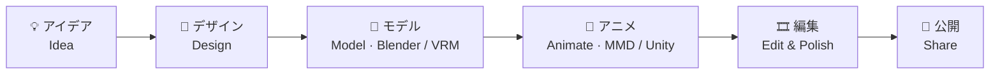

<div align="center">


<br/>

<a href="https://github.com/quincy-dev"></a>
<a href="https://zetalyn.my.id"></a>


<br/><br/>

🏮 &nbsp; ⛩️ &nbsp; 🌸 &nbsp; **「技術と創造性、その交差点に。」** &nbsp; 🌸 &nbsp; ⛩️ &nbsp; 🏮<br/>
<sub>Where technology meets creativity.</sub>

</div>

<br/>

<div align="center">

`⛩️ ━━━━━━━━━ 🌸 ━━━━━━━━━ ⛩️`

</div>

## 🎴 自己紹介 &nbsp;·&nbsp; Profile

<table>
<tr>
<td width="62%" valign="top">

こんにちは！ Hi, I'm **Quincy** (クインシー), a software engineering student from Indonesia 🇮🇩

I like understanding how things work behind the screen, then making them feel good on the surface. Code is one half of my world. The other half is **anime-inspired visuals, 3D, MMD, character design, motion, and video editing**.

I'm drawn to the place where engineering meets creativity: software that works *and* feels designed, creative work that's expressive *and* built with a technical mindset.

I learn best by **making things**, breaking them, and making them better. Japanese language and culture are a big part of that journey, from anime and Vocaloid to the writing system itself.

</td>
<td width="38%" valign="top">

```yaml
名前: Quincy (クインシー)
肩書き: Software Eng. Student
所在地: Indonesia 🇮🇩
好き:
  - アニメ
  - ボカロ / J-POP
  - 3D / MMD / VRM
  - モーション編集
勉強中: 日本語
座右の銘: Understand → Build → Refine
```

</td>
</tr>
</table>

<div align="center">

`⛩️ ━━━━━━━━━ 🌸 ━━━━━━━━━ ⛩️`

</div>

## 🗡️ キャラクターシート &nbsp;·&nbsp; Character Sheet

<div align="center">

| 項目 | Detail |
| :-- | :-- |
| 🎭 **職業 / Class** | Creative Technologist (Software Engineering Student) |
| 🌸 **属性 / Element** | Sakura × Code × Motion |
| ⚔️ **武器 / Weapons** | HTML · CSS · JavaScript · Python · C++ · Java |
| 🎮 **魔法 / Magic** | Unity · Blender · MMD · VRM |
| 📖 **修行中 / In Training** | 日本語 (Japanese) |
| 🧭 **信条 / Creed** | 小さく始めて、少しずつ良くする |
| 🐾 **相棒 / Companion** | Zetalyn (original character) |

</div>

<div align="center">


</div>

<div align="center">

`⛩️ ━━━━━━━━━ 🌸 ━━━━━━━━━ ⛩️`

</div>

## 🛠️ 装備 &nbsp;·&nbsp; Tech Arsenal

Languages and tools I've learned and worked with. This is my learning path, not a claim of mastery over every item.

<div align="center">

**⌨️ &nbsp;言語 · Languages & Web Foundations**<br/><br/>


<br/><br/>

**🎮 &nbsp;ゲーム & 3D · Game Dev & 3D Creation**<br/><br/>


</div>

<div align="center">

`⛩️ ━━━━━━━━━ 🌸 ━━━━━━━━━ ⛩️`

</div>

## ⚡ 何をしているか &nbsp;·&nbsp; What I Do

<table>
<tr>
<td width="50%" valign="top">

### 💻 &nbsp;コード · Code & Interfaces

- Building small web projects and experiments
- Practicing across multiple languages
- Exploring game development with Unity
- Crafting clean, user-focused interfaces
- Playing with APIs, automation, and AI features

</td>
<td width="50%" valign="top">

### 🎨 &nbsp;創作 · Creative & Visual

- Designing intentional, modern UI with an anime-inspired eye
- Creating and animating 3D characters
- MMD projects and anime-style visuals
- Exploring VRM character workflows
- Video editing and motion graphics

</td>
</tr>
</table>

<div align="center">

`⛩️ ━━━━━━━━━ 🌸 ━━━━━━━━━ ⛩️`

</div>

## 🚀 作品 &nbsp;·&nbsp; Works & Experiments

Some are practical software projects, others are creative experiments. They keep evolving.

| | 作品 · Project | 説明 · What it is |
| :-: | --- | --- |
| 🛫 | **AeroLink** | Laravel-based freelance web platform with role-based access and database-backed workflows. |
| 📜 | **Certigen** | Web app experiment built with Next.js, Prisma, and a hosted database. |
| 🎵 | **QueenMusic** | Music web project exploring lyrics data and synchronized LRC lyrics. |
| 📥 | **SaveIt / FastGrabber** | Experiments around convenient media and link workflows. |
| 🤖 | **Line Bot** | Serverless LINE bot with an AI-powered auto-response workflow. |
| 🌙 | **Zetalyn Creative Projects** | Anime-inspired character, MMD, 3D, and video experiments around my original character, Zetalyn. |

<div align="center">

`⛩️ ━━━━━━━━━ 🌸 ━━━━━━━━━ ⛩️`

</div>

## 🌙 主役 &nbsp;·&nbsp; Spotlight: Zetalyn

<table>
<tr>
<td width="35%" align="center" valign="middle">

<!-- Tambahkan art Zetalyn kamu di sini, contoh:

-->

# 🌙

**Zetalyn**<br/>
<sub>ゼタリン · Original Character</sub>

</td>
<td width="65%" valign="top">

Zetalyn is the original character concept at the center of my creative experiments. She's the muse behind my anime-inspired visuals, and the character I bring into **MMD, VRM, 3D, and video projects**.

Every experiment is a chance to learn something new: modeling, rigging, animation, lighting, editing, and the technical glue that connects them.

<a href="https://zetalyn.my.id"></a>

</td>
</tr>
</table>

<div align="center">

`⛩️ ━━━━━━━━━ 🌸 ━━━━━━━━━ ⛩️`

</div>

## 🎬 制作の流れ &nbsp;·&nbsp; Creative Pipeline

How an idea becomes something you can see and play with:



<div align="center">

`⛩️ ━━━━━━━━━ 🌸 ━━━━━━━━━ ⛩️`

</div>

## 🗾 日本語の旅 &nbsp;·&nbsp; My Japanese Journey

I'm learning Japanese and enjoy exploring it beyond vocabulary: its writing systems, expressions, media, and everyday culture. It's a long journey, one step at a time. 🍵

<table>
<tr>
<td width="33%" align="center" valign="top">

### あ
**ひらがな**<br/>
Hiragana

The core phonetic script, the foundation of everything.

</td>
<td width="33%" align="center" valign="top">

### ア
**カタカナ**<br/>
Katakana

For loanwords, names, and sound effects in anime.

</td>
<td width="33%" align="center" valign="top">

### 漢
**漢字**<br/>
Kanji

Characters with meaning, learned slowly and steadily.

</td>
</tr>
</table>

### 💬 好きなフレーズ &nbsp;·&nbsp; Phrases I Like

<div align="center">

| 日本語 | Romaji | Meaning |
| :-: | :-: | :-: |
| はじめまして | Hajimemashite | Nice to meet you |
| ありがとう | Arigatou | Thank you |
| がんばろう | Ganbarou | Let's do our best |
| いってきます | Ittekimasu | I'm heading out (and I'll be back) |
| またね | Mata ne | See you later |

</div>

<div align="center">

`⛩️ ━━━━━━━━━ 🌸 ━━━━━━━━━ ⛩️`

</div>

## 🎤 アニメ & 音楽 &nbsp;·&nbsp; Anime, Music & Vocaloid

<table>
<tr>
<td width="33%" valign="top" align="center">

### 🎞️ アニメ
**Anime**

The visual language of anime, from color and framing to character design and motion, shapes how I think about interfaces and creative work.

</td>
<td width="33%" valign="top" align="center">

### 🎶 ボカロ
**Vocaloid**

Vocaloid is a huge source of inspiration for me, and I love building visual projects that move along with the music.

</td>
<td width="33%" valign="top" align="center">

### 🎧 J-POP
**J-Pop & Anime Songs**

Music keeps me going while I code, model, and edit. It's also how I pick up new Japanese words.

</td>
</tr>
</table>

<div align="center">

`⛩️ ━━━━━━━━━ 🌸 ━━━━━━━━━ ⛩️`

</div>

## 📜 クエストログ &nbsp;·&nbsp; Quest Log

<table>
<tr>
<td width="50%" valign="top">

### 🔥 進行中 · In Progress

- [ ] Keep studying Japanese (hiragana → katakana → kanji)
- [ ] Build more projects with Unity and the languages I've learned
- [ ] Improve my 3D, MMD, and VRM workflows
- [ ] Polish Zetalyn's creative projects

</td>
<td width="50%" valign="top">

### 🌟 目標 · Goals

- [ ] Understand how larger software systems are structured
- [ ] Create a full anime-inspired video from start to finish
- [ ] Combine code and 3D into one interactive project
- [ ] Keep learning, keep refining, keep sharing

</td>
</tr>
</table>

<div align="center">

`⛩️ ━━━━━━━━━ 🌸 ━━━━━━━━━ ⛩️`

</div>

## 📊 統計 &nbsp;·&nbsp; GitHub

<div align="center">


<br/><br/>

<a href="https://github.com/quincy-dev">
  
</a>

<br/>

<sub>Stats are built from simple, stable badges so nothing breaks from API rate limits.</sub>

</div>

<!--
  OPSIONAL · Animasi ular (snake) dari kontribusi.
  1) Pastikan nama repo profil kamu persis: quincy-dev
  2) Taruh file .github/workflows/snake.yml (sudah disediakan), lalu jalankan workflow sekali di tab Actions.
  3) Setelah branch "output" terbentuk, hapus tanda komentar ini:

<div align="center">
  
</div>
-->

<br/>

<div align="center">

`⛩️ ━━━━━━━━━ 🌸 ━━━━━━━━━ ⛩️`

</div>

## 💌 連絡先 &nbsp;·&nbsp; Find Me

<div align="center">

<a href="https://github.com/quincy-dev"></a>
<a href="https://zetalyn.my.id"></a>

<br/><br/>

🌸 &nbsp;**「小さく始めて、少しずつ良くする。」**&nbsp; 🌸<br/>
<sub>Start small. Make it better, step by step.</sub>

<br/><br/>

### またね ✿ See you around!

<sub>Thanks for stopping by. Build with intention. Create with curiosity.</sub>

<br/>

`(｡•̀ᴗ-)✧ がんばろう！`


</div>
